# WG2FA — WireGuard VPN with two-factor authentication

Self-hosted WireGuard VPN server with **TOTP 2FA**, **VPN profiles**, **site-to-site routers**, a **web GUI**, and native **macOS and Windows clients**.

WireGuard itself has no login step: anyone holding a valid key can connect. WG2FA adds one. A device's peer is only loaded into WireGuard **while its owner has a valid 2FA session**. When the session expires or is revoked, the server removes the peer and the tunnel stops passing traffic.

```
 ┌──────────────┐  password + TOTP (HTTPS)   ┌──────────────────────────────┐
 │ WG2FA client │ ─────────────────────────▶ │ wg2fa-server                 │
 │ macOS / Win  │ ◀── tunnel config ──────── │  · web GUI + client API      │
 │ (wireguard-go│                            │  · users / profiles / audit  │
 │  embedded)   │ ══ WireGuard UDP 51820 ══▶ │  · reconciler → wg0 peers    │
 └──────────────┘                            └──────────────────────────────┘
   phones / wg-quick: import config, unlock in the web portal with a 2FA code
   routers (MikroTik, OpenWrt, OPNsense, pfSense): always-on site-to-site peers
```

## Screenshots

| | |
|---|---|
| **Dashboard:** all peers, online status, handshakes, traffic<br>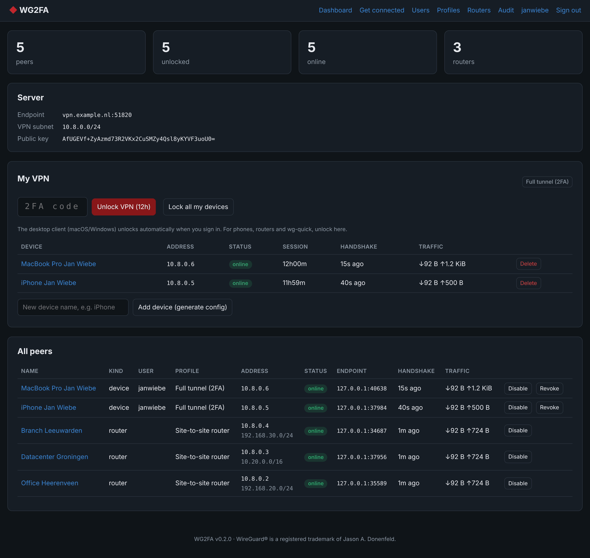 | **Get connected:** self-service guide with client downloads<br>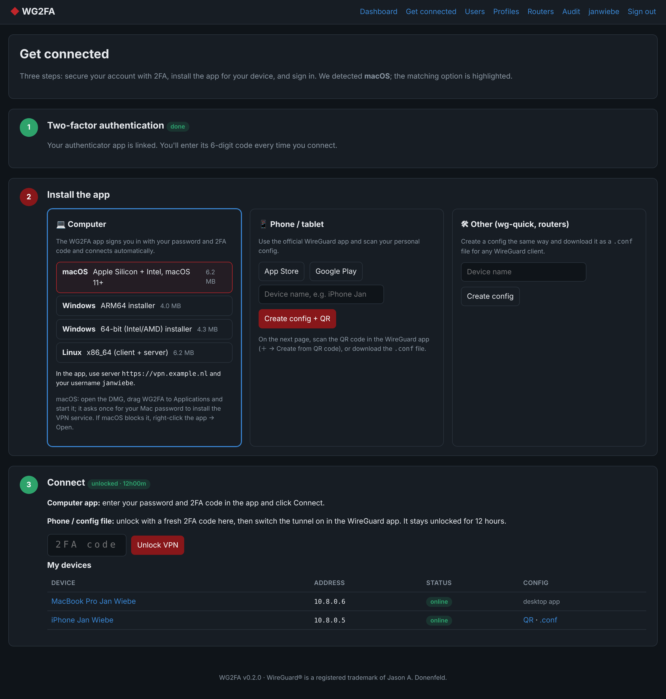 |
| **2FA enrolment:** scan the QR code with any authenticator app<br>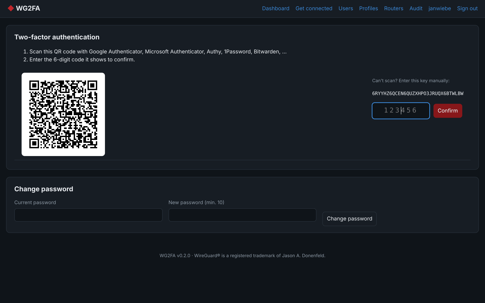 | **Sign in:** password, then a 6-digit code<br>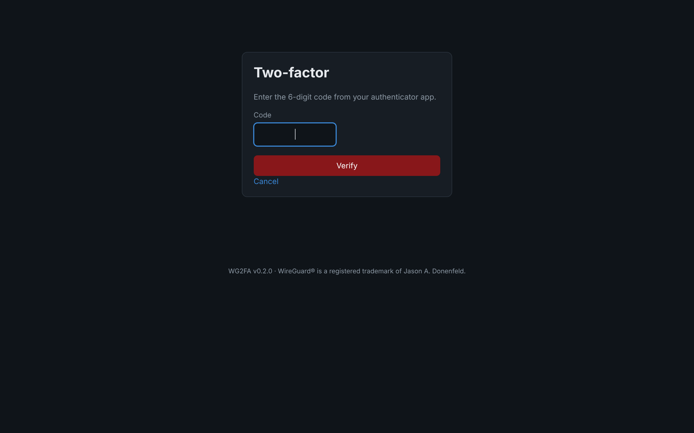 |
| **Desktop client:** sign in with password + 2FA<br>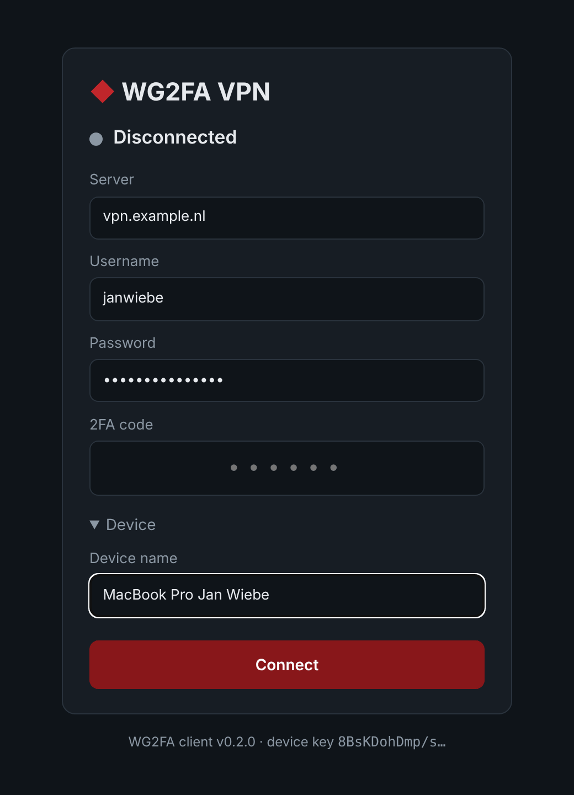 | **Desktop client:** connected<br>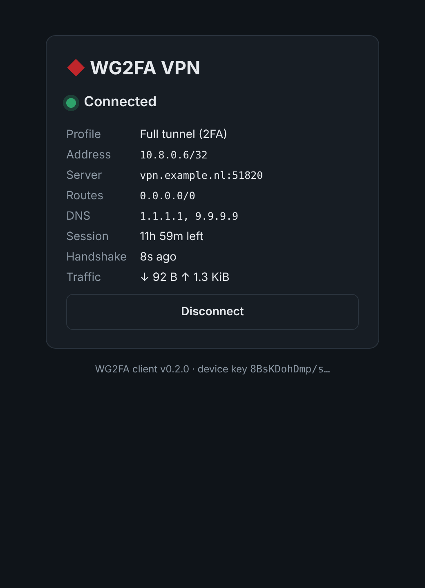 |
| **Phone config:** QR code for the WireGuard app<br>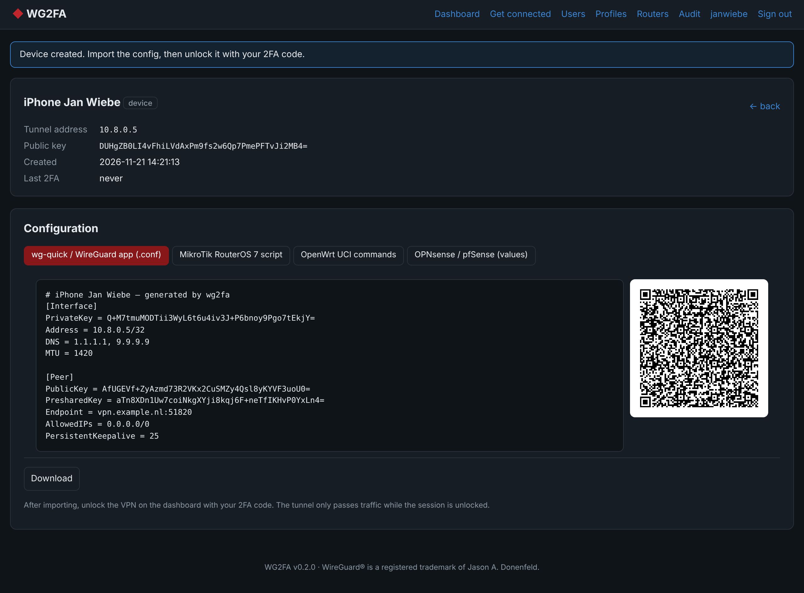 | **Users:** profiles, roles, 2FA status and resets<br>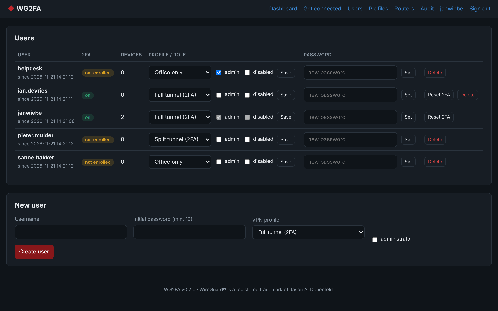 |
| **VPN profiles:** routes, DNS, session length, 2FA required<br>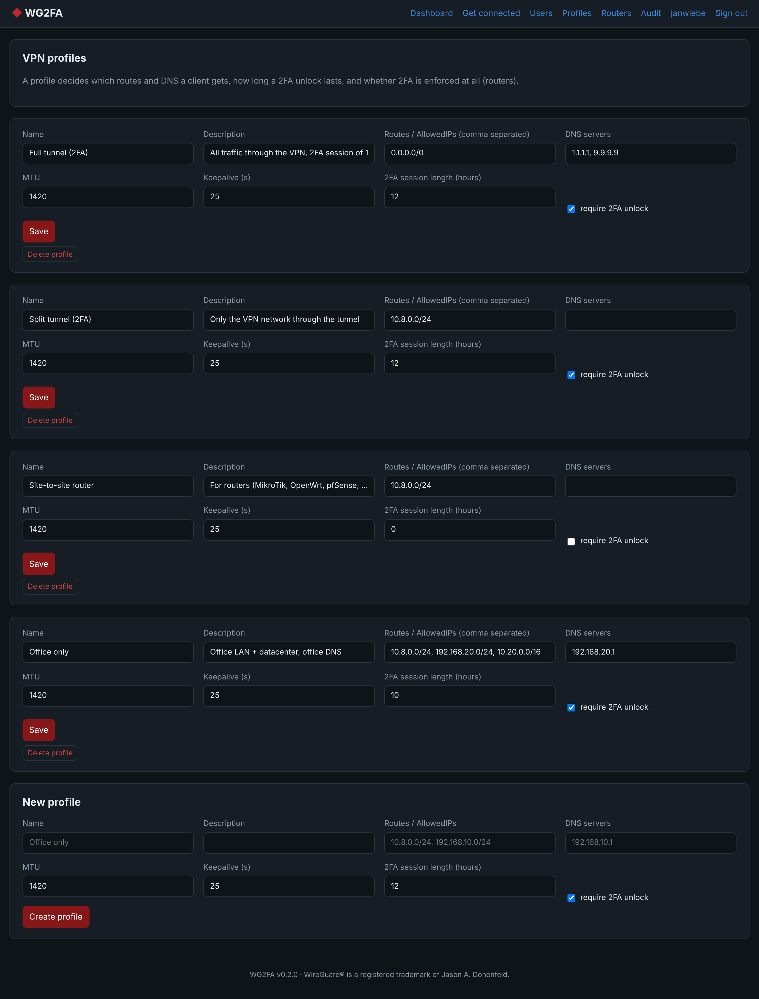 | **Routers:** site-to-site peers with their LANs<br>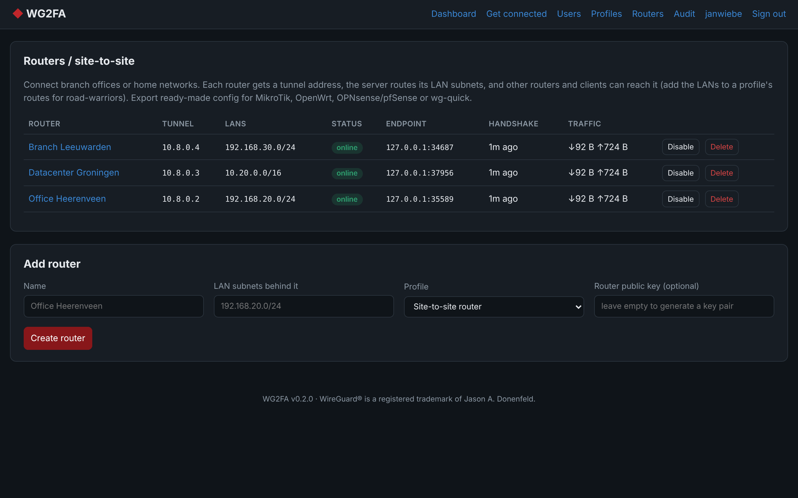 |
| **Router export:** MikroTik / OpenWrt / OPNsense / wg-quick<br>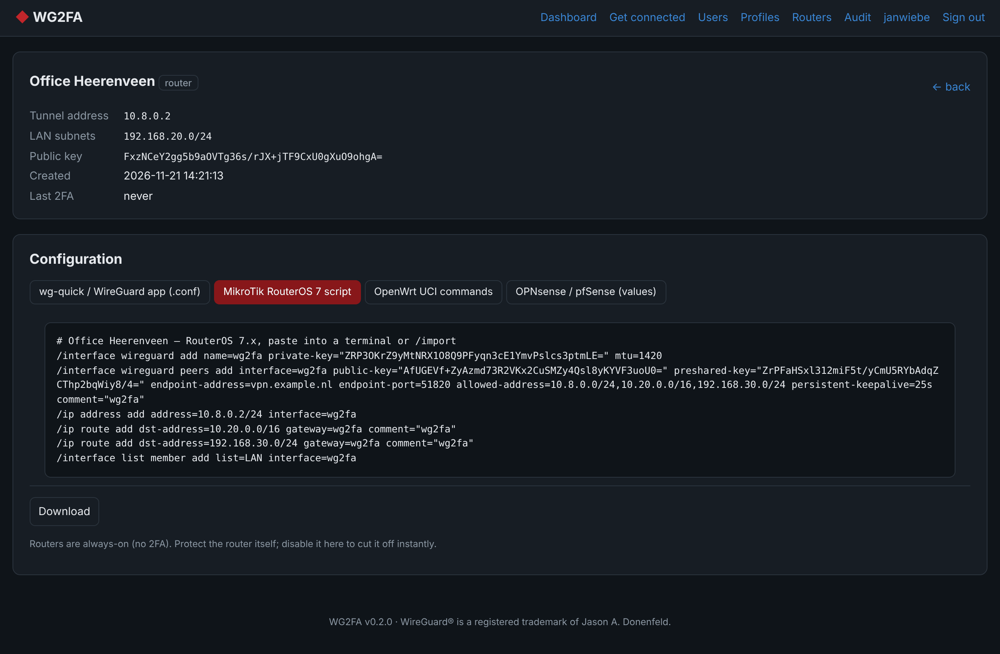 | **Audit log:** logins, 2FA failures, changes<br>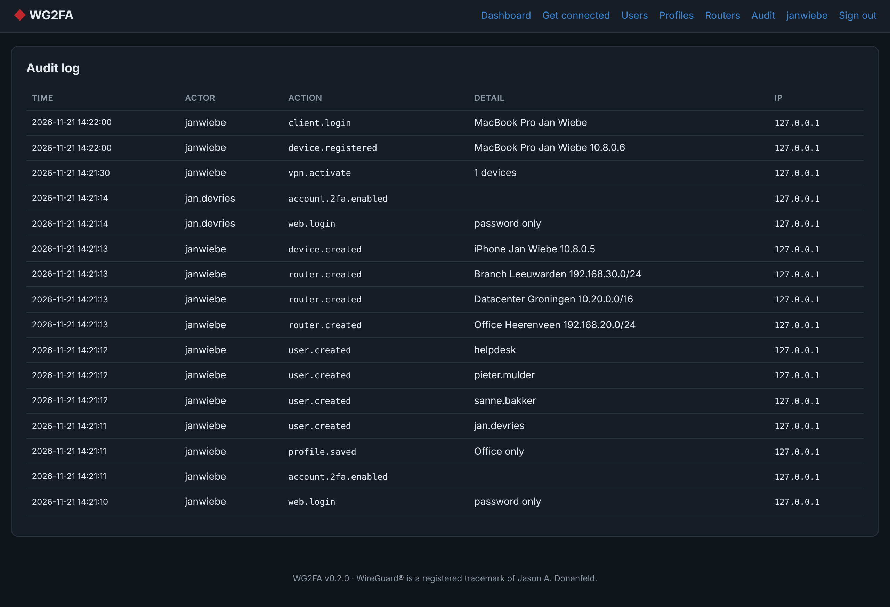 |
| **Light mode:** follows the system setting<br>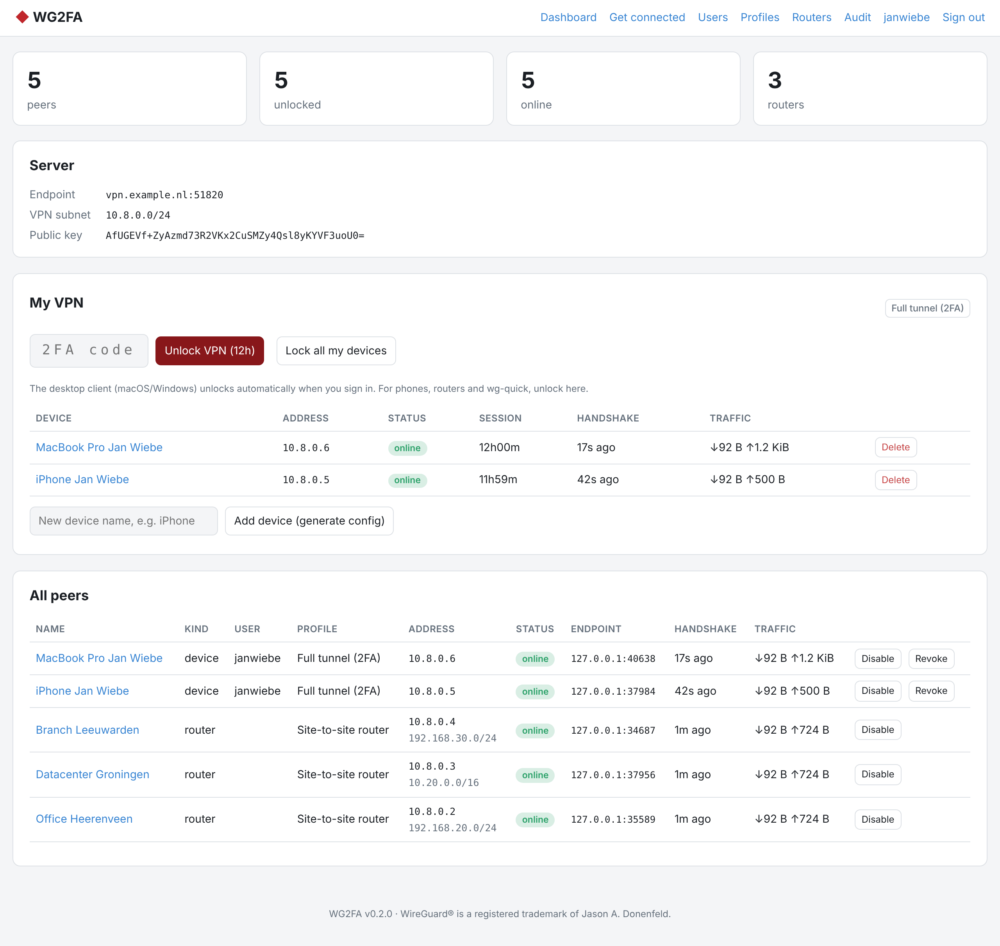 | **Login**<br>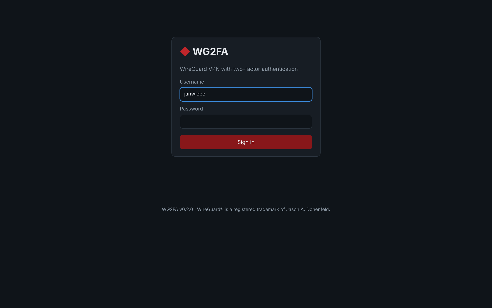 |

<sub>Screenshots come from a throwaway demo instance; all keys shown are demo keys.</sub>

## Features

- **2FA everywhere.** TOTP (RFC 6238) works with Google/Microsoft Authenticator, Authy, 1Password and Bitwarden. Enrolment uses a QR code. Codes can't be replayed, and failed logins are rate-limited. Admins must enrol.
- **VPN sessions.** A device is unlocked for the profile's session length (default 12 h), then it is removed from WireGuard automatically. Admins can revoke a session or disable a device instantly.
- **VPN profiles.** Each profile sets its routes (full or split tunnel), DNS, MTU, keepalive, session length, and whether 2FA is required.
- **Routers and site-to-site.** Add a router with its LAN subnets. The server routes them, and other routers reach them too. Configs export to **MikroTik RouterOS 7**, **OpenWrt UCI**, **OPNsense/pfSense** and **wg-quick**.
- **Self-service portal ("Get connected").** Users enrol 2FA with a QR code and download the desktop client for their OS (detected automatically; the installers ship inside the Docker image). They can also create a phone config with a QR code for the WireGuard app, download `.conf` files, and unlock the VPN with a 2FA code.
- **Web GUI.** It has a dashboard (online, handshake, traffic), users, profiles, routers, an audit log, and self-service devices with QR codes for the mobile WireGuard apps.
- **Desktop clients.** The macOS `.dmg` (universal) and Windows `setup.exe` (x64 and arm64) embed wireguard-go, so they need no separate WireGuard install. Sign in with password and 2FA code, then connect.
- **Single static binary.** The server is a Go binary plus a JSON state file. It ships as a multi-arch Docker image (amd64 and arm64).

## Quick start (server, Docker)

```bash
mkdir wg2fa && cd wg2fa
curl -O https://raw.githubusercontent.com/jwklijnsma/wireguard/main/docker-compose.yml
# edit WG2FA_ENDPOINT to your public hostname
openssl rand -base64 32 > state.key && chmod 600 state.key   # encrypts state at rest
docker compose up -d
docker compose logs wg2fa | grep -A2 "first start"   # initial admin password
```

Next, put the web GUI (port 8080) behind HTTPS. Clients send passwords and 2FA codes to it, so it must not run over plain HTTP on the internet. Here is an example with Caddy:

```caddyfile
vpn.example.nl {
    reverse_proxy 127.0.0.1:8080
}
```

Set `WG2FA_TRUST_PROXY=true` when running behind a proxy. Alternatively, set `WG2FA_TLS_CERT` / `WG2FA_TLS_KEY` and expose 8080 directly. Then open UDP **51820** on your firewall.

Prefer Podman? [`packaging/podman`](packaging/podman/README.md) has a Quadlet unit that runs the same container as a systemd service (`wg2fa.service`), with auto-updates.

The kernel WireGuard module is used when the host has it. Otherwise the image falls back to the bundled userspace `wireguard-go`, which needs `/dev/net/tun`.

### Configuration

| Variable | Default | Description |
|---|---|---|
| `WG2FA_ENDPOINT` | — (required) | Public host[:port] clients connect to |
| `WG2FA_SUBNET` | `10.8.0.0/24` | VPN IPv4 subnet (`.1` is the server) |
| `WG2FA_WG_PORT` | `51820` | WireGuard UDP port |
| `WG2FA_LISTEN` | `:8080` | Web GUI / API |
| `WG2FA_ISSUER` | `WG2FA VPN` | Name shown in authenticator apps |
| `WG2FA_ADMIN_USER` / `WG2FA_ADMIN_PASSWORD` | `admin` / random | Initial admin (first start only) |
| `WG2FA_TLS_CERT` / `WG2FA_TLS_KEY` | — | Serve HTTPS directly |
| `WG2FA_TRUST_PROXY` | `false` | Honour `X-Forwarded-For/-Proto` |
| `WG2FA_NAT` | `1` | MASQUERADE VPN traffic to the default interface |
| `WG2FA_MTU` | `1420` | Interface MTU |
| `WG2FA_DOWNLOADS` | `/data/downloads:/usr/share/wg2fa/downloads` | Folders whose client installers are offered on *Get connected*. Files in `/data/downloads` override the bundled ones, e.g. your own signed builds |
| `WG2FA_FIREWALL` | `true` | Default-deny forwarding policy per peer/profile (see [SECURITY.md](SECURITY.md)) |
| `WG2FA_BLOCK_NETS` | — | CIDRs no VPN peer may reach (management networks) |
| `WG2FA_ADMIN_NETS` | — | CIDRs allowed to use the admin pages |
| `WG2FA_TRUSTED_PROXIES` | private ranges | Proxies whose `X-Forwarded-*` headers are trusted (with `WG2FA_TRUST_PROXY`) |
| `WG2FA_HSTS` | `false` | Send HSTS on HTTPS |
| `WG2FA_STATE_KEY` / `_FILE` | — | Encrypt `state.json` at rest (16+ chars) |
| `WG2FA_DRYRUN` | `false` | Don't touch WireGuard (GUI development) |

All state (keys, users, peers, audit) lives in `/data/state.json` (mode 0600, optionally encrypted). For an encrypted backup, run `docker exec wg2fa wg2fa-server backup /data/backup-$(date +%F).enc`.

**Before going to production, read [SECURITY.md](SECURITY.md).** It has the forwarding policy, hardening options and a deployment OPSEC checklist.

## Using it

1. **Admin:** sign in, scan the QR code to enrol 2FA, and create users (each user gets a profile).
   Send users the server URL. On first login they land on **Get connected** (`/connect`), which walks them through 2FA, downloading the right app or phone config, and connecting.
2. **macOS:** open the DMG, drag *WG2FA* to Applications and start it. It asks once for an admin password to install the VPN service. Then enter server, username, password and 2FA code, and click Connect.
3. **Windows:** run `WG2FA-…-setup.exe`. It installs the service and opens the client. Sign in the same way.
4. **Phones / wg-quick:** on the dashboard, use *Add device*, then scan the QR code with the WireGuard app. Before connecting, unlock the VPN on the dashboard with your 2FA code.
5. **Routers:** go to *Routers → Add router*, enter the LAN subnets, and pick your router's export format. Paste the result into the router. To give road-warriors access to a router's LAN, add that subnet to their profile's routes.

The desktop client UI runs locally at <http://127.0.0.1:51821>. It accepts only loopback requests with the correct Host header, and every state change needs a custom header, so other websites can't drive it.

## Releases (automatic)

Every push to `main` is released automatically (workflow *Auto release*). The next version follows the commit messages since the last tag:

| Commits since last release | Bump |
|---|---|
| `feat:` / `feat(scope):` (also as PR title in a merge commit) | minor: `v1.2.0` → `v1.3.0` |
| `type!:` or `BREAKING CHANGE` | major (minor while on `0.x`) |
| anything else | patch: `v1.2.0` → `v1.2.1` |

No release is made when only CI, docs or Renovate config changed (`.github/`, `docs/`, `*.md`, `renovate.json`), or when the commit message contains `[skip release]`. To force a release, use *Actions → Auto release → Run workflow* and pick `patch`, `minor` or `major`. Pushing a tag by hand still works too:

```bash
git tag v1.0.0 && git push origin v1.0.0
```

Each release contains:

- `WG2FA-v1.0.0-macos-universal.dmg`
- `WG2FA-1.0.0-windows-x64-setup.exe`, `…-arm64-setup.exe` and portable zips (with `wintun.dll`)
- `wg2fa-v1.0.0-linux-{amd64,arm64}.tar.gz`
- Docker image `ghcr.io/jwklijnsma/wireguard:1.0.0`, `:1.0` and `:latest` (multi-arch)
- `SHA256SUMS.txt`

You can also start a release from *Actions → Release → Run workflow* with a version.

**macOS signing (optional).** Without secrets the app is ad-hoc signed, so Gatekeeper asks once: right-click → *Open*. For a Developer ID signed and notarized DMG, add these repository secrets: `MACOS_CERT_P12_BASE64`, `MACOS_CERT_PASSWORD`, `MACOS_SIGN_IDENTITY` (e.g. `Developer ID Application: Name (TEAMID)`), `APPLE_ID`, `APPLE_TEAM_ID`, `APPLE_APP_PASSWORD`.

## Development

```bash
go mod tidy            # first time: creates go.sum (commit it)
go test ./...
WG2FA_DATA=./data WG2FA_DRYRUN=1 WG2FA_ENDPOINT=localhost WG2FA_ADMIN_PASSWORD=changeme123 \
  go run ./cmd/wg2fa-server -listen 127.0.0.1:8080
sudo WG2FA_CLIENT_DIR=/tmp/wg2fa go run ./cmd/wg2fa-client run    # client on Linux
```

Layout:

```
cmd/wg2fa-server      server entry point
cmd/wg2fa-client      desktop client entry point
internal/server       store, auth, 2FA flow, wg reconciler, web GUI, API, router exports
internal/client       wireguard-go tunnel, OS network config (darwin/windows/linux), services, local UI
internal/totp         RFC 6238 TOTP (stdlib only)
packaging/            Dockerfile entrypoint, macOS app/DMG, Windows Inno Setup
```

### Client API

| Endpoint | Body / auth | Result |
|---|---|---|
| `POST /api/v1/client/login` | `{username,password,totp,public_key,device_name}` | `{token, expires_at, profile, config}` |
| `GET /api/v1/client/status` | `Authorization: Bearer <token>` | `{active, expires_at, …}` |
| `POST /api/v1/client/logout` | `Authorization: Bearer <token>` | ends the session |

The device generates its own key pair; the private key never leaves the device.

## Security notes and limitations

- The tunnel is **IPv4 only** for now. On full-tunnel profiles the desktop client blocks IPv6 (routed into the tunnel and dropped), so it cannot leak.
- **Windows DNS:** the tunnel's DNS servers are set on the WG2FA adapter with a low metric, but there is no firewall-based leak protection yet (the official client uses WFP rules for that).
- **Routers** can't do TOTP, so they are always on. Disable a router in the GUI to cut it off.
- Web sessions are kept in memory, so a server restart signs everyone out of the GUI. VPN sessions are persisted and survive restarts.

WireGuard® is a registered trademark of Jason A. Donenfeld. This project is not affiliated with the WireGuard project.
