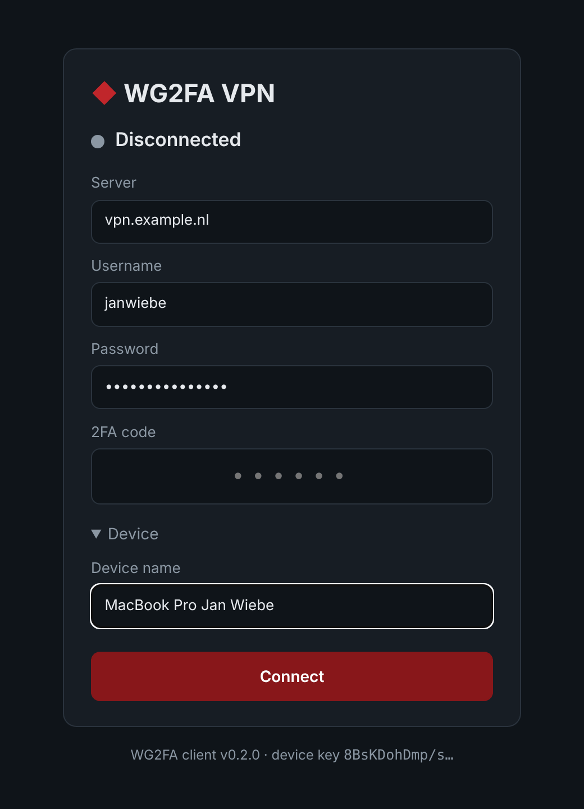
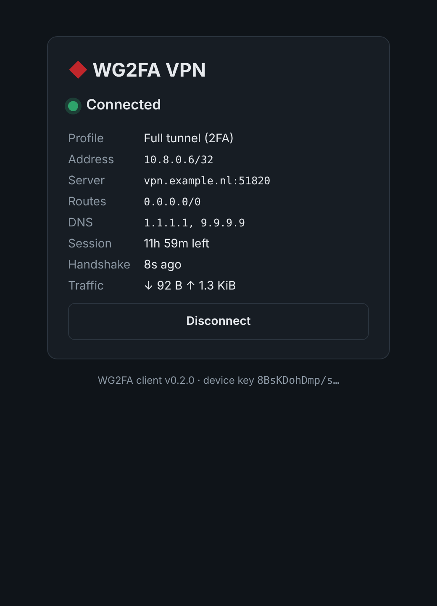

# Desktop clients

The macOS and Windows clients embed `wireguard-go`, so they need no separate WireGuard install. Users sign in with password and 2FA code; the client gets a tunnel config and connects. Download them from the [latest release](https://github.com/jwklijnsma/wireguard/releases/latest) or from the server's *Get connected* page.

=== "macOS"

    1. Open `WG2FA-…-macos-universal.dmg` (Apple Silicon + Intel) and drag *WG2FA* to Applications.
    2. Start it. It asks once for an admin password to install the VPN service.
    3. Enter server, username, password and 2FA code, and click **Connect**.

    !!! note "Gatekeeper"
        Unless the release was built with a Developer ID, the app is ad-hoc signed and Gatekeeper asks once: right-click → *Open*.

=== "Windows"

    1. Run `WG2FA-…-windows-x64-setup.exe` (or `-arm64-setup.exe`). It installs the service and the Wintun driver, then opens the client.
    2. Sign in with server, username, password and 2FA code.

    A portable zip (with `wintun.dll`) is also part of each release.

=== "Linux"

    The release has `wg2fa-…-linux-{amd64,arm64}.tar.gz` with `wg2fa-client`. Run it as root:

    ```bash
    sudo ./wg2fa-client run
    ```

| | |
|---|---|
|  |  |

## Local UI

The client UI runs locally at <http://127.0.0.1:51821>. It accepts only loopback requests with the correct Host header, and every state change needs a custom header, so other websites can't drive it.

## Keys

The device generates its own key pair. The private key never leaves the device.

## Known limitations

- The tunnel is **IPv4 only**. On full-tunnel profiles the client routes all global IPv6 (`2000::/3`) into the tunnel, where it is dropped, so IPv6 cannot leak; the client shows *IPv6: blocked*.
- **Windows DNS:** the tunnel's DNS servers are set on the WG2FA adapter with a low metric, but there is no firewall-based (WFP) leak protection yet.
