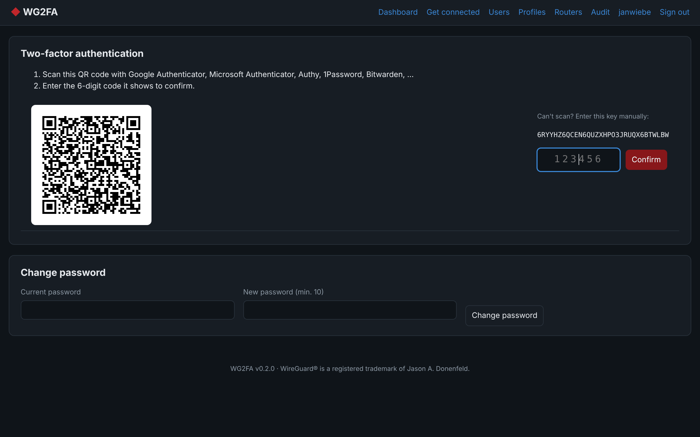
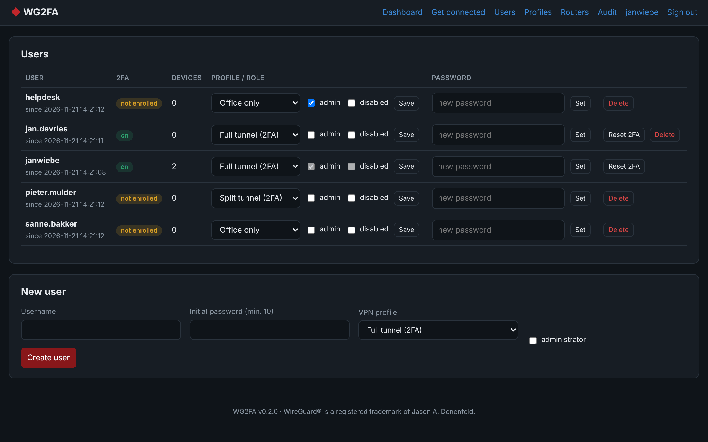
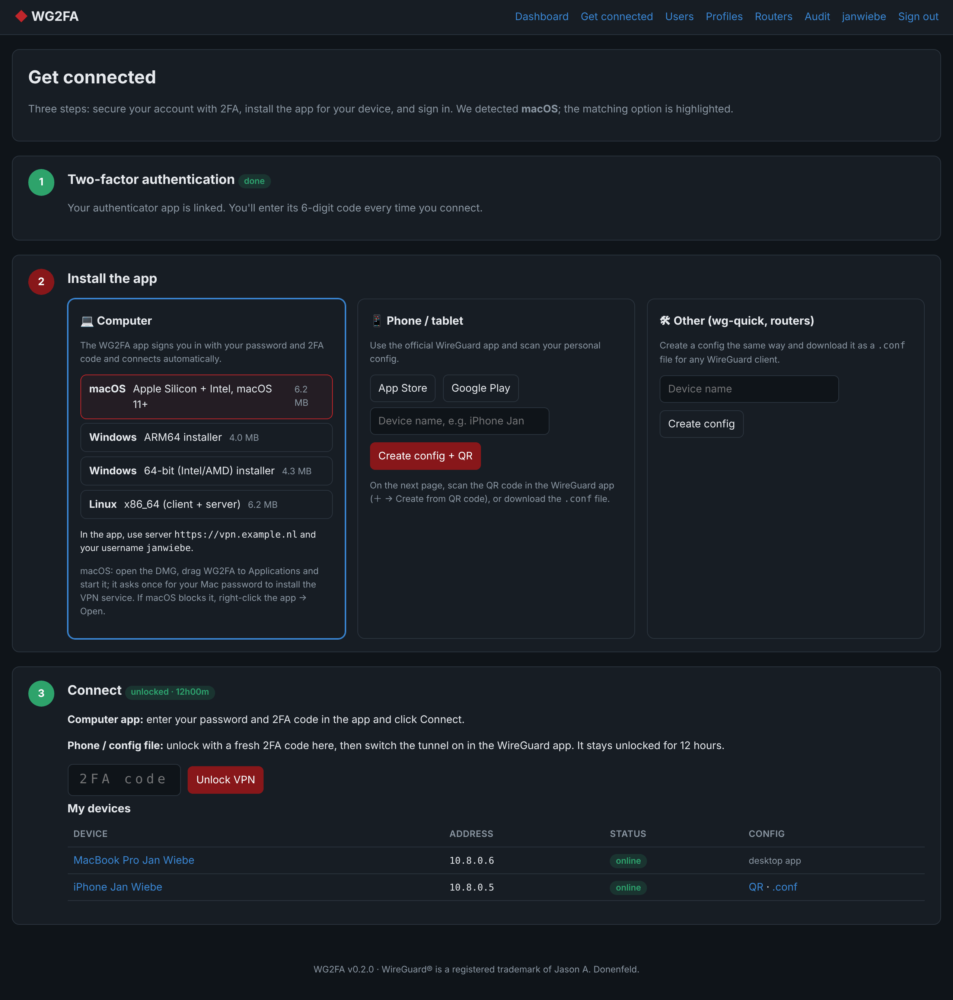

# Getting started

1. **Sign in as admin.** Use the initial password from the log (or `WG2FA_ADMIN_PASSWORD`). You must enrol 2FA first: scan the QR code with an authenticator app.

    

2. **Create profiles.** A [VPN profile](profiles.md) decides what a user's devices can reach and how long a session lasts.

3. **Create users** and give each one a profile.

    

4. **Send users the server URL.** On first login they land on **Get connected** (`/connect`). It walks them through enrolling 2FA, downloading the right app or phone config, and connecting.

    

From there, users connect with the [desktop clients](clients.md) or with the official WireGuard app on [phones](phones.md). Add [routers](routers.md) for site-to-site links.

## Sessions

A device's peer is only present in WireGuard while its owner has a valid 2FA session:

- The session lasts the profile's session length (default 12 h), then the peer is removed automatically.
- Admins can revoke a session or disable a device instantly from the dashboard.
- VPN sessions are persisted and survive server restarts. Web GUI sessions are kept in memory, so a restart signs everyone out of the GUI.
