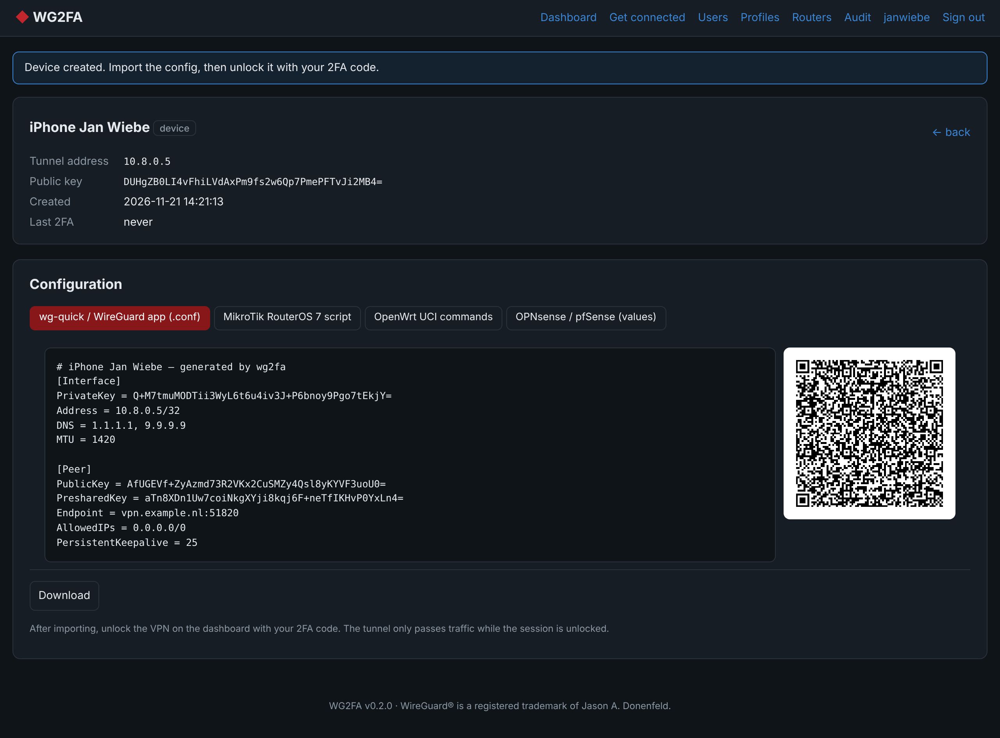

# Phones & wg-quick

Phones and Linux `wg-quick` use the official WireGuard apps with a config from WG2FA. They can't do the 2FA step themselves, so you unlock the VPN in the web portal.

1. On the dashboard, choose **Add device**.
    - **Recommended:** first create an empty tunnel in the WireGuard app (*Create from scratch*), copy its **public key**, and paste it into *Public key*. The private key then never leaves the phone; put it into the config yourself.
    - Or leave *Public key* empty to get a generated config.
2. Scan the QR code with the WireGuard app, or download the `.conf` file for `wg-quick`.

    !!! note "One-time key"
        A generated private key is held in server memory only until the device's first handshake (at most 15 minutes) and is never stored. After that the page shows `<YOUR-PRIVATE-KEY>`; use **Rotate keys** on the device page to get a new config.

    

3. Before connecting, **unlock the VPN** on the dashboard with your 2FA code. The device works until the session expires.

!!! warning "IPv6 on phones"
    The official WireGuard apps do not block IPv6 by themselves, and the tunnel carries IPv4 only. Add `::/0` to the profile's routes to capture IPv6 into the tunnel too.
