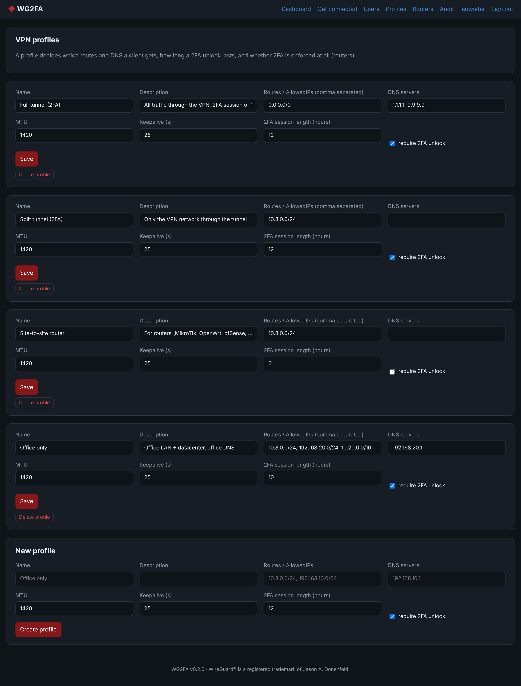

# VPN profiles

Every user has a profile. It sets:

| Setting | Meaning |
|---|---|
| Routes | What the device sends into the tunnel and may reach: `0.0.0.0/0` for full tunnel, or explicit networks for split tunnel |
| DNS | DNS servers pushed to the device |
| MTU, keepalive | Tunnel parameters |
| Session length | How long a 2FA unlock lasts (default 12 h) |
| 2FA required | Whether devices must be unlocked with a code |
| Allow peer-to-peer | Off by default: peers can't reach each other |

## Full vs split tunnel

A full-tunnel profile (`0.0.0.0/0`) can reach the internet and any internal network not listed in `WG2FA_BLOCK_NETS`. For road-warriors that should only reach specific systems, use a split-tunnel profile that lists exactly those networks.

The profile's routes are also enforced on the server by the [forwarding policy](../security/forwarding-policy.md): a device can't reach a network just by adding it to its own config.
