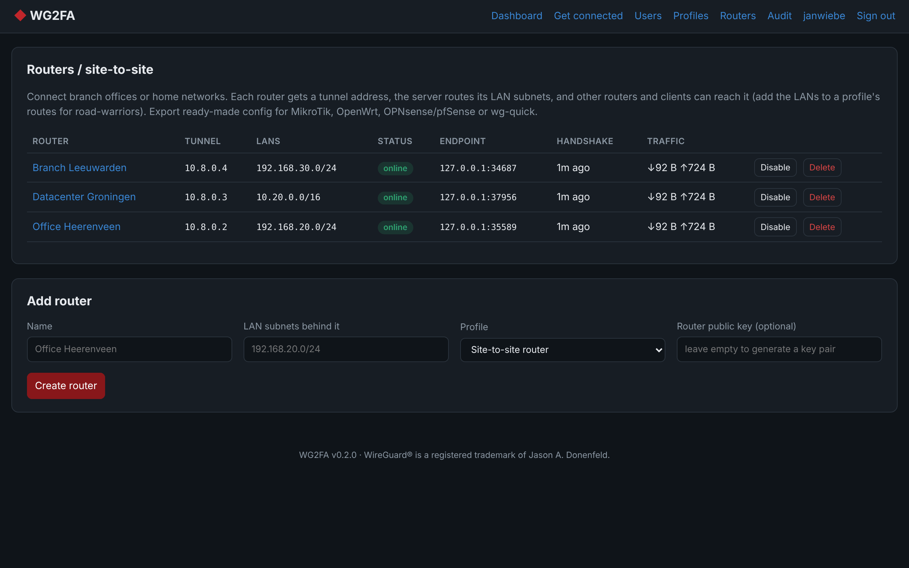
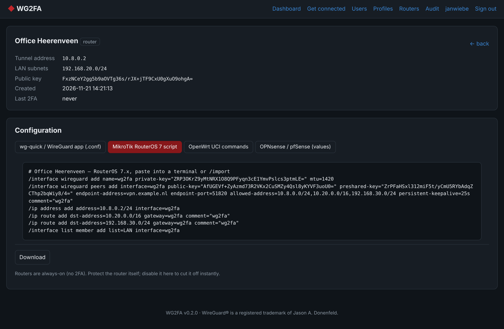

# Routers (site-to-site)

Routers are always-on peers: they can't do TOTP, so they don't need a session. The server routes their LAN subnets, and other routers reach them too.

1. Go to **Routers → Add router** and enter the router's LAN subnets.

    

2. Pick your router's export format and paste the result into the router:

    | Format | For |
    |---|---|
    | MikroTik RouterOS 7 | `/interface wireguard` script |
    | OpenWrt UCI | `uci` commands |
    | OPNsense / pfSense | settings to enter in the WireGuard plugin |
    | wg-quick | generic Linux |

    

3. To give road-warriors access to a router's LAN, add that subnet to their [profile's routes](profiles.md).

!!! warning
    Routers are always on, so their LANs are trusted entry points. Protect them with their own controls, review their subnets, and disable a router in the GUI to cut it off immediately.
