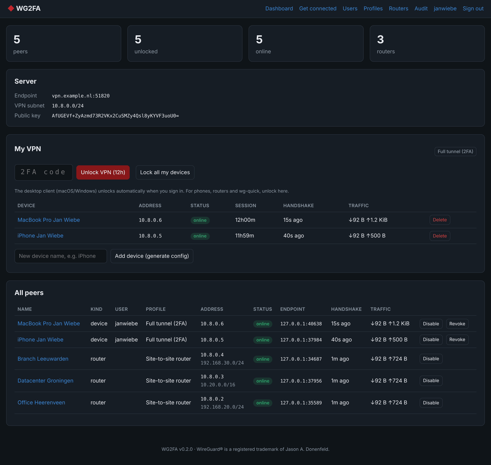

# WG2FA: WireGuard VPN with two-factor authentication

Self-hosted WireGuard VPN server with **TOTP 2FA**, **VPN profiles**, **site-to-site routers**, a **web GUI**, and native **macOS and Windows clients**.

[Install with Docker](install/docker.md){ .md-button .md-button--primary }
[Download a release](https://github.com/jwklijnsma/wireguard/releases/latest){ .md-button }



## How it works

WireGuard itself has no login step: anyone holding a valid key can connect. WG2FA adds one. A device's peer is only loaded into WireGuard **while its owner has a valid 2FA session**. When the session expires or is revoked, the server removes the peer and the tunnel stops passing traffic.

```
 ┌──────────────┐  password + TOTP (HTTPS)   ┌──────────────────────────────┐
 │ WG2FA client │ ─────────────────────────▶ │ wg2fa-server                 │
 │ macOS / Win  │ ◀── tunnel config ──────── │  · web GUI + client API      │
 │ (wireguard-go│                            │  · users / profiles / audit  │
 │  embedded)   │ ══ WireGuard UDP 51820 ══▶ │  · reconciler → wg0 peers    │
 └──────────────┘                            └──────────────────────────────┘
   phones / wg-quick: import config, unlock in the web portal with a 2FA code
   routers (MikroTik, OpenWrt, OPNsense, pfSense): always-on site-to-site peers
```

## Features

<div class="grid cards" markdown>

-   :material-two-factor-authentication: **2FA everywhere**

    ---

    TOTP (RFC 6238) with Google/Microsoft Authenticator, Authy, 1Password or Bitwarden. QR enrolment, replay protection and rate-limited logins. Admins must enrol.

-   :material-timer-sand: **VPN sessions**

    ---

    A device is unlocked for the profile's session length (default 12 h), then removed from WireGuard automatically. Admins can revoke a session or disable a device instantly.

-   :material-tune-variant: **VPN profiles**

    ---

    Per-profile routes (full or split tunnel), DNS, MTU, keepalive, session length, and whether 2FA is required.

-   :material-router-network: **Routers and site-to-site**

    ---

    Add routers with their LAN subnets. Export configs to **MikroTik RouterOS 7**, **OpenWrt UCI**, **OPNsense/pfSense** and **wg-quick**.

-   :material-account-arrow-right: **Self-service portal**

    ---

    *Get connected* walks users through 2FA enrolment, the right client download for their OS, phone configs with QR codes, and unlocking the VPN.

-   :material-monitor-dashboard: **Web GUI**

    ---

    Dashboard (online, handshake, traffic), users, profiles, routers, an audit log, and self-service devices.

-   :material-laptop: **Desktop clients**

    ---

    Universal macOS `.dmg` and Windows `setup.exe` (x64 and arm64) with wireguard-go embedded, so no separate WireGuard install is needed.

-   :material-docker: **Single static binary**

    ---

    A Go binary plus a JSON state file, shipped as a multi-arch (amd64/arm64) Docker image that is scanned, SBOM'd and cosign-signed.

</div>

## Next steps

- [Install the server](install/index.md) with Docker or Podman, then put it [behind HTTPS](install/reverse-proxy.md).
- [Get started](guide/getting-started.md): enrol 2FA as admin and create users.
- Read the [security notes](security/index.md) before going to production.
