# Screenshots

!!! note
    Screenshots come from a throwaway demo instance; all keys shown are demo keys.

## Web GUI

**Dashboard:** all peers, online status, handshakes, traffic

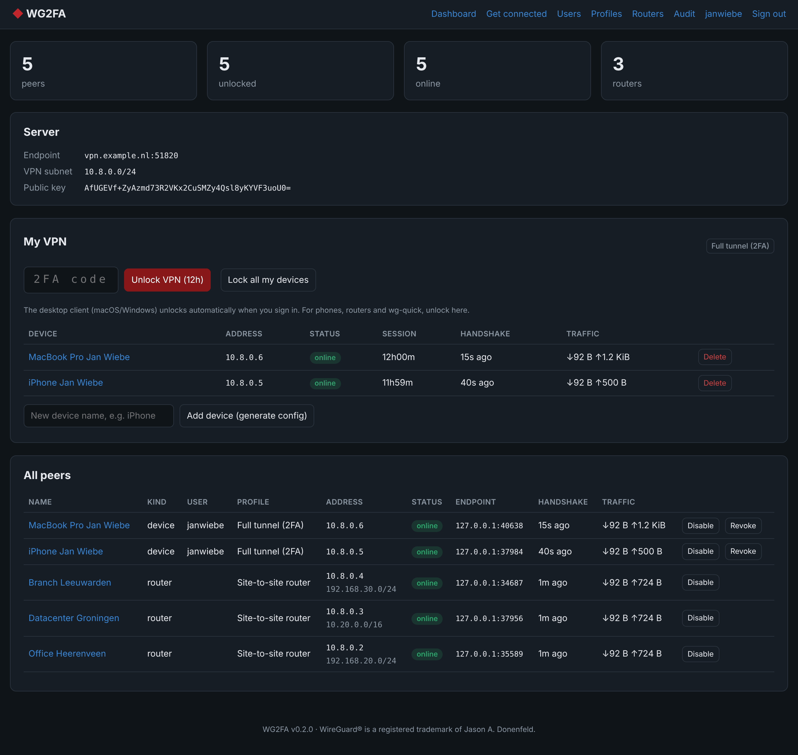

**Light mode:** follows the system setting

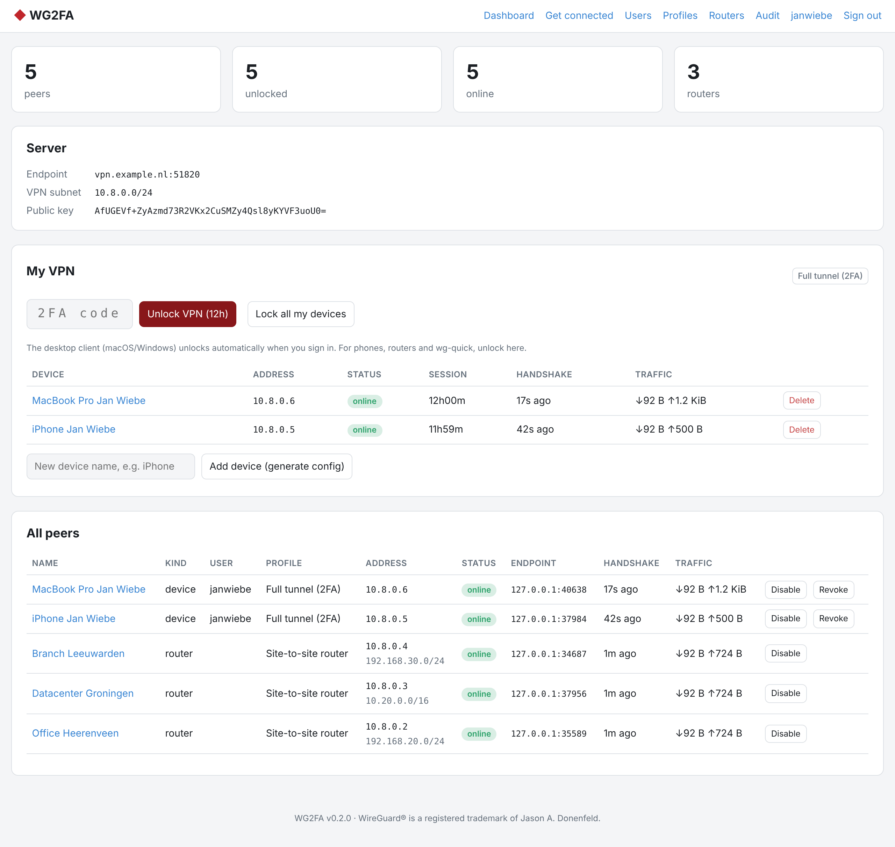

**Get connected:** self-service guide with client downloads

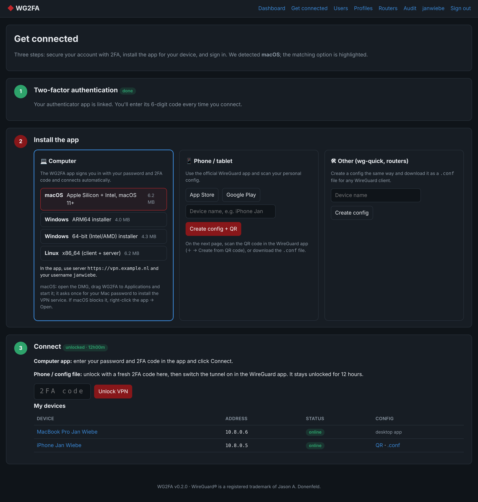

**Users:** profiles, roles, 2FA status and resets

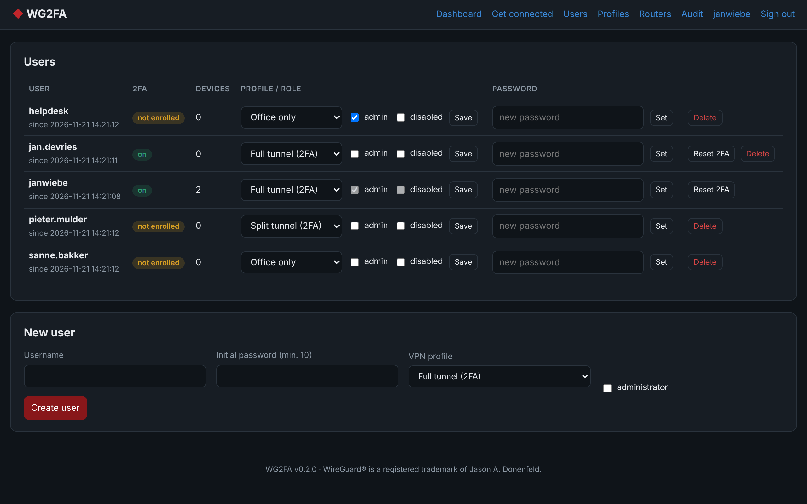

**VPN profiles:** routes, DNS, session length, 2FA required

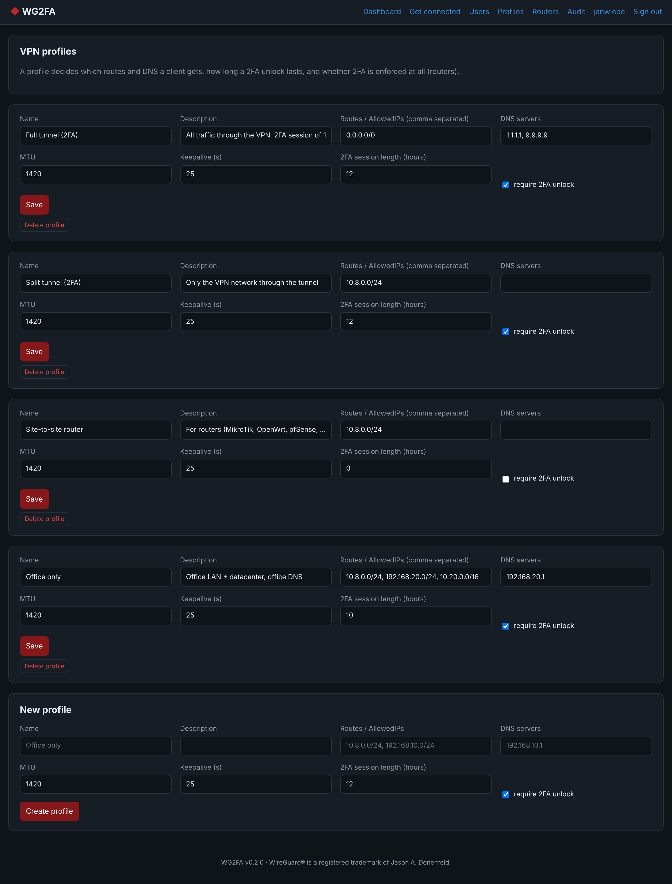

**Phone config:** QR code for the WireGuard app

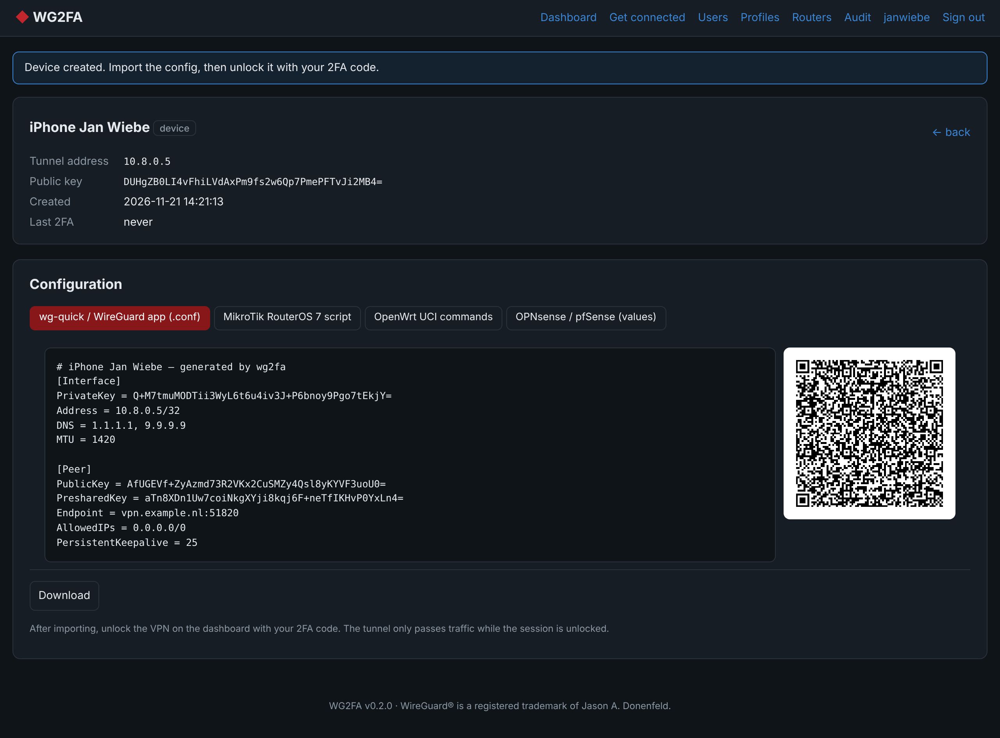

**Routers:** site-to-site peers with their LANs

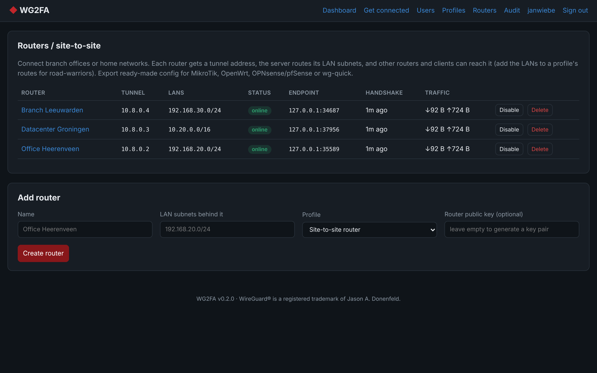

**Router export:** MikroTik / OpenWrt / OPNsense / wg-quick

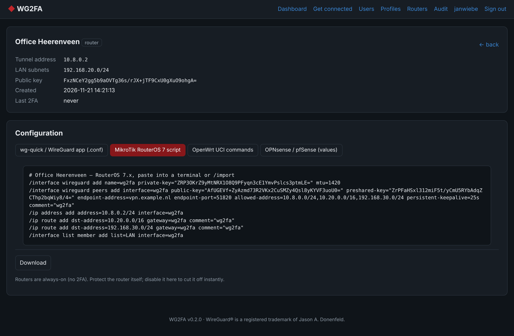

**Audit log:** logins, 2FA failures, changes

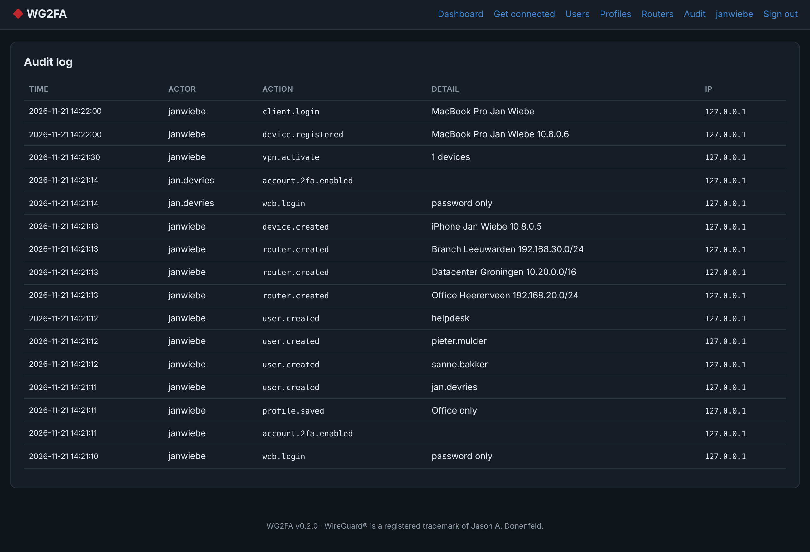

## Sign-in and 2FA

**Login**

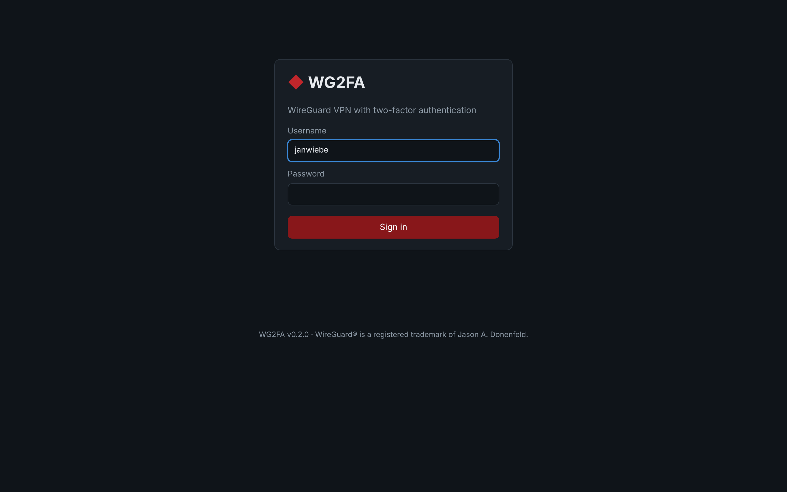

**Sign in:** password, then a 6-digit code

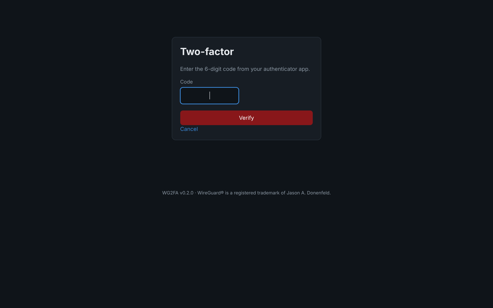

**2FA enrolment:** scan the QR code with any authenticator app

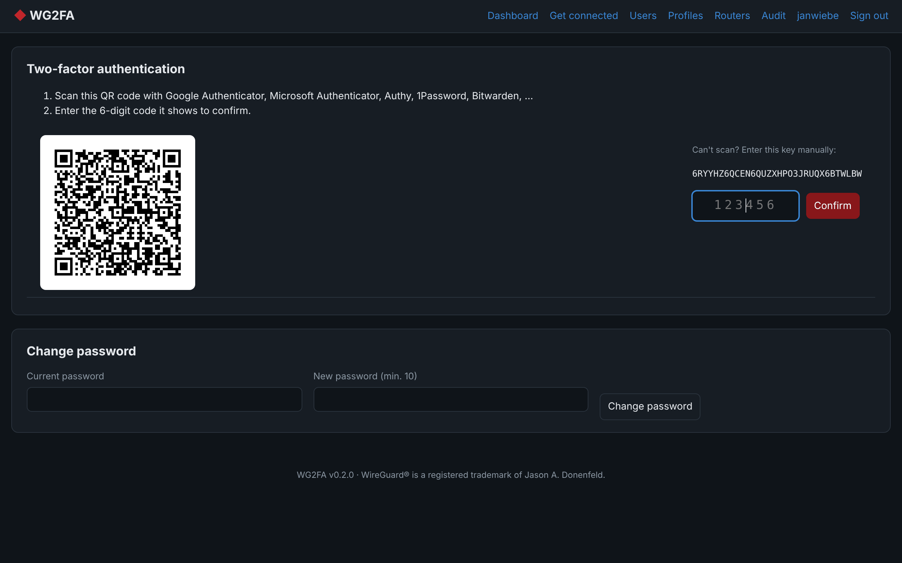

## Desktop client

**Sign in** with password + 2FA

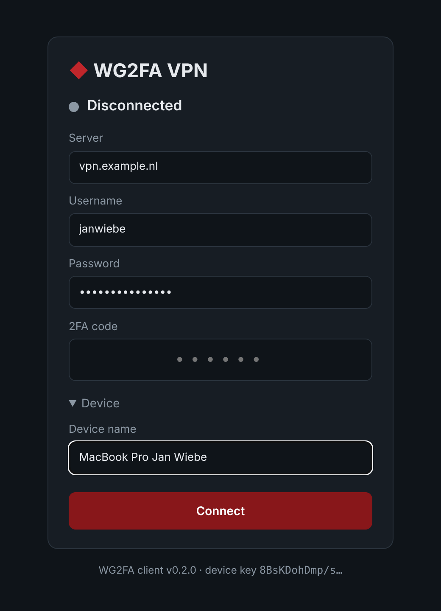

**Connected**

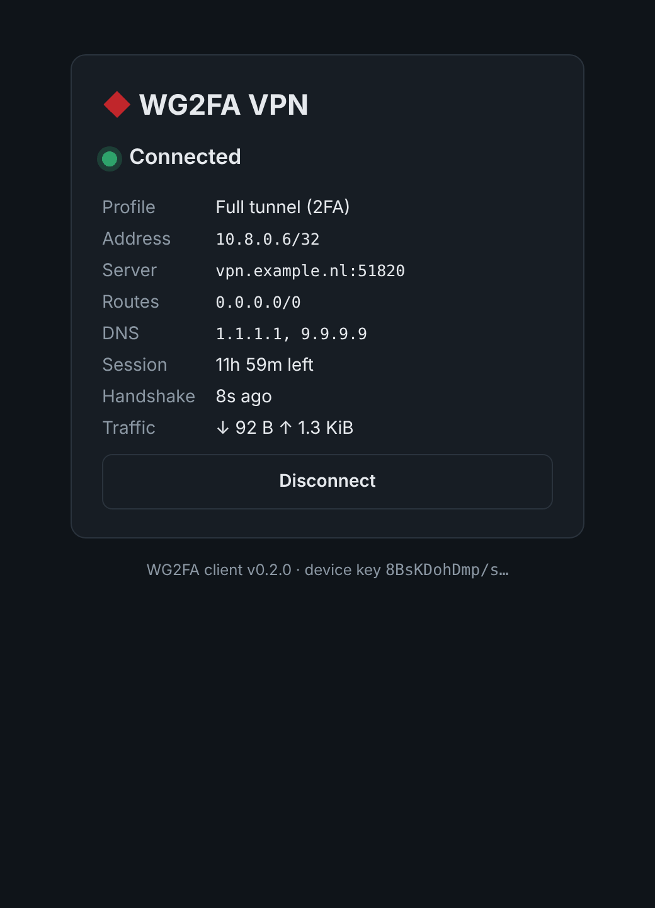
